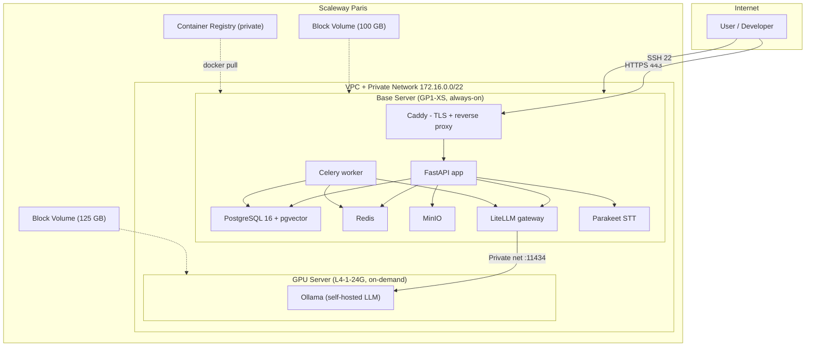

# Reusable Scaleway Terraform Infrastructure

Parameterized Terraform project that provisions an EU-based, self-hosted AI prototyping
platform on Scaleway. Change a single `tfvars` file to spin up isolated infrastructure
for a new project — no hardcoded assumptions about any particular application.

## Architecture



## Prerequisites

| Tool | Version | Purpose |
|------|---------|---------|
| Terraform | >= 1.5 | Infrastructure provisioning |
| Scaleway account | -- | Cloud resources |
| SSH key | -- | Registered in Scaleway console |

Optional: `scw` CLI for registry login and instance management.

## Quick Start

```bash
cd infrastructure/terraform

# 1. Install providers
terraform init

# 2. Configure your project
cp terraform.tfvars.example terraform.tfvars
# Edit terraform.tfvars with your values

# 3. Preview changes
terraform plan

# 4. Provision infrastructure
terraform apply
```

After apply completes:

```bash
# SSH into the base server
$(terraform output -raw ssh_command_base)

# On the server, your project data directory is ready:
ls /opt/<project_name>-data/
# .env  litellm-config.yaml  (and repo/ if repo_url was set)

# Deploy your application stack
cd /opt/<project_name>-data/repo   # or clone your repo here
cp docker-compose.yml Caddyfile /opt/<project_name>-data/
cd /opt/<project_name>-data
docker compose up -d
```

## Spinning Up a New Project

Each project gets its own infrastructure — VPC, servers, registry, credentials:

```bash
# Create a new tfvars file
cp terraform.tfvars.example acme.tfvars

# Edit: set project_name, domain, credentials
vim acme.tfvars

# Use a separate workspace to isolate state
terraform workspace new acme
terraform apply -var-file=acme.tfvars

# Switch back to another project
terraform workspace select default
```

Alternatively, use separate directories per project with their own state files.

## Variable Reference

### Identity

| Variable | Type | Default | Description |
|----------|------|---------|-------------|
| `project_name` | string | -- (required) | Lowercase name for all resources (3-32 chars, `[a-z0-9-]`) |
| `domain` | string | -- (required) | Primary domain for TLS and DNS |

### Scaleway Credentials

| Variable | Type | Default | Description |
|----------|------|---------|-------------|
| `scw_access_key` | string | -- (required) | API access key (sensitive) |
| `scw_secret_key` | string | -- (required) | API secret key (sensitive) |
| `scw_project_id` | string | -- (required) | Project UUID |
| `scw_region` | string | `fr-par` | Region for regional resources |
| `scw_zone` | string | `fr-par-1` | AZ for the base instance |

### Base Instance

| Variable | Type | Default | Description |
|----------|------|---------|-------------|
| `base_instance_type` | string | `GP1-XS` | Instance type (4 vCPU, 16 GB) |
| `base_image` | string | `ubuntu_noble` | OS image label or UUID |
| `base_volume_size_gb` | number | `100` | Block storage size |
| `base_volume_iops` | number | `5000` | Block storage IOPS |

### GPU Instance

| Variable | Type | Default | Description |
|----------|------|---------|-------------|
| `gpu_enabled` | bool | `false` | Provision GPU server |
| `gpu_instance_type` | string | `L4-1-24G` | GPU instance type |
| `gpu_image` | string | `ubuntu_noble_gpu` | GPU OS image (NVIDIA drivers pre-installed) |
| `gpu_zone` | string | `fr-par-1` | AZ for GPU (may differ from base) |
| `gpu_volume_size_gb` | number | `125` | Block storage for models |
| `gpu_volume_iops` | number | `5000` | Block storage IOPS |

### Self-Hosted Models

| Variable | Type | Default | Description |
|----------|------|---------|-------------|
| `llm_model` | string | `qwen2.5:14b-instruct-q4_K_M` | Ollama chat model tag |
| `embedding_model` | string | `nomic-embed-text` | Ollama embedding model tag |

### Access and Networking

| Variable | Type | Default | Description |
|----------|------|---------|-------------|
| `ssh_key_ids` | list(string) | -- (required) | Scaleway SSH key IDs |
| `tailscale_auth_key` | string | `""` | Tailscale auth key (empty = skip) |
| `manage_dns` | bool | `false` | Create Scaleway DNS A record |

### Application Wiring

| Variable | Type | Default | Description |
|----------|------|---------|-------------|
| `repo_url` | string | `""` | Git repo to clone on base (empty = skip) |
| `anthropic_api_key` | string | `""` | For LiteLLM paid-provider passthrough |

## Key Outputs

```bash
terraform output base_public_ip       # Public IP for DNS and SSH
terraform output gpu_private_ip       # Private IP for OLLAMA_URL wiring
terraform output registry_endpoint    # Docker push/pull endpoint
terraform output ssh_command_base     # Ready-to-use SSH command
terraform output ssh_command_gpu      # SSH via jump host (if GPU enabled)
terraform output -raw rendered_env    # Full .env file (contains secrets!)
terraform output data_dir             # Server-side data directory path
```

## What Terraform Creates vs. What You Deploy

**Terraform owns** (infrastructure layer):
- VPC, private network, security groups
- Compute instances with cloud-init bootstrap
- Block storage volumes
- Container registry namespace
- DNS records (optional)
- Generated `.env` and `litellm-config.yaml` with auto-generated secrets

**You own** (application layer):
- `docker-compose.yml` — service definitions
- `Caddyfile` — reverse proxy routing rules
- Application code and Docker images
- Database migrations
- CI/CD pipeline

This separation means Terraform creates a Docker-ready server with credentials
pre-configured, and you choose what application to deploy on it.

## GPU Workflow

The GPU instance is off by default (`gpu_enabled = false`). To use it:

```bash
# Enable GPU in your tfvars
# gpu_enabled = true

terraform apply

# Terraform provisions the GPU server, installs NVIDIA toolkit,
# starts Ollama, pulls your configured models, and wires the
# private IP into the .env OLLAMA_URL automatically.

# To stop paying for GPU when idle:
# gpu_enabled = false
terraform apply
# WARNING: this destroys the GPU instance. Models on block storage persist
# only if you don't also delete the volume.
```

## State Management

Terraform state contains plain-text secrets (database passwords, JWT secrets, API keys).

**Local state** (single developer):
- State files are in `terraform.tfstate` — **never commit these**
- Add to `.gitignore`: `*.tfstate`, `*.tfstate.backup`, `.terraform/`

**Remote state** (team / production):

```hcl
# Add to versions.tf:
terraform {
  backend "s3" {
    bucket                      = "my-terraform-state"
    key                         = "myproject/terraform.tfstate"
    region                      = "fr-par"
    endpoints                   = { s3 = "https://s3.fr-par.scw.cloud" }
    skip_credentials_validation = true
    skip_region_validation      = true
    skip_requesting_account_id  = true
    skip_metadata_api_check     = true
    skip_s3_checksum            = true
  }
}
```

## Cost Estimate

| Resource | Pricing | Notes |
|----------|---------|-------|
| Base server (GP1-XS) | ~66 EUR/month | Always-on |
| GPU server (L4-1-24G) | ~0.75 EUR/hour | On-demand, off by default |
| Block storage (100 GB) | ~8 EUR/month | Base data volume |
| Block storage (125 GB) | ~10 EUR/month | GPU models (only when GPU enabled) |
| Container Registry | Free tier | Up to 75 GB |
| Flexible IPs | ~3 EUR/month each | 1 base + 1 GPU (when enabled) |
| **Base-only total** | **~77 EUR/month** | Without GPU |

## Tearing Down

```bash
# Destroy all resources for the current workspace
terraform destroy

# WARNING: Block volumes and their data are destroyed.
# Export data before destroying if needed.
```

## Importing Existing Resources

If you already have manually provisioned Scaleway resources (e.g. the LAED project),
you can import them into Terraform state instead of recreating:

```bash
# Example: import an existing instance
terraform import scaleway_instance_server.base fr-par-1/<instance-id>

# Example: import an existing registry namespace
terraform import scaleway_registry_namespace.main fr-par/<namespace-id>

# Example: import a VPC
terraform import scaleway_vpc.main fr-par/<vpc-id>
```

After importing, run `terraform plan` to verify the configuration matches the
live resources. Fix any drift before applying changes.

## File Reference

| File | Purpose |
|------|---------|
| `main.tf` | Provider configuration |
| `versions.tf` | Required providers and versions |
| `variables.tf` | All input variables |
| `terraform.tfvars.example` | Template for project-specific values |
| `network.tf` | VPC, private network, security groups |
| `compute.tf` | Instances, IPs, private NICs, IPAM lookups |
| `storage.tf` | Block storage volumes |
| `registry.tf` | Container registry namespace |
| `dns.tf` | Optional DNS A record |
| `secrets.tf` | Auto-generated credentials |
| `outputs.tf` | IPs, endpoints, rendered configs |
| `cloud-init/base.yaml.tftpl` | Base server bootstrap template |
| `cloud-init/gpu.yaml.tftpl` | GPU server bootstrap template |
| `templates/env.tftpl` | `.env` file template |
| `templates/litellm-config.tftpl` | LiteLLM config template |
